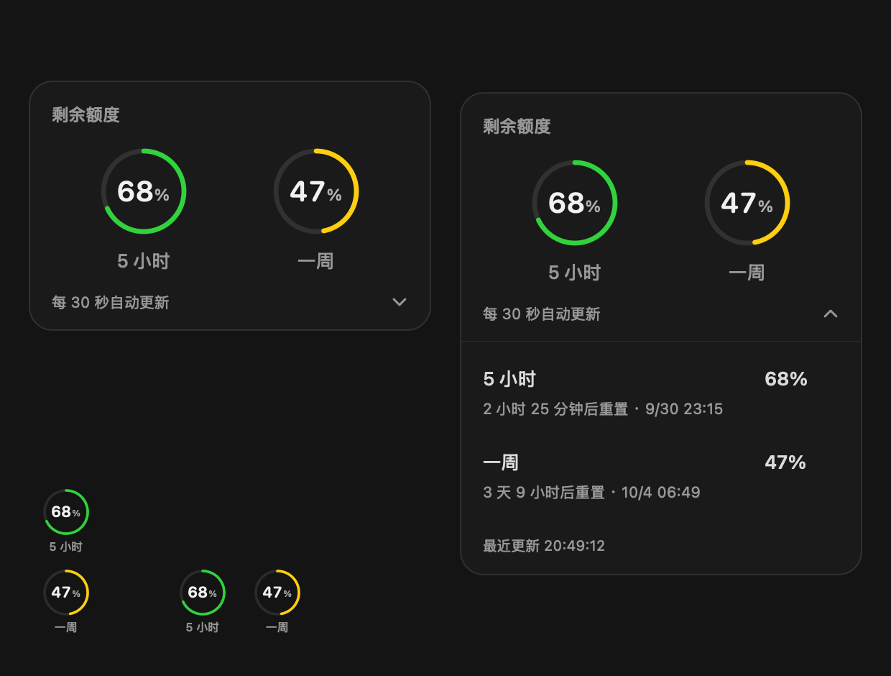

# Codex Quota Rings

**English** · [简体中文](README.zh-CN.md)

A small native macOS widget for the remaining Codex quota in the 5-hour and weekly windows. It offers compact rings, an expandable desktop-style card, and private quota trends.



## Install and use

The packaged app is zero-configuration. Download or receive `Quota-Rings.app.zip`, unzip it, move **Quota Rings.app** to Applications, and open it. Quota Rings automatically discovers the registered Codex app, standard application folders, Homebrew locations, and the executable path. No Terminal command or path setting is needed.

Open Codex and sign in normally. If Codex is absent, the expanded widget shows **Install Codex**. Discovery and connection retry automatically.

The release is a **Universal 2** app for Apple Silicon and Intel Macs, with macOS 12 as the minimum app target when a compatible Codex installation is available. This community build is ad-hoc signed rather than notarized. If Gatekeeper blocks it, use System Settings → Privacy & Security → Open Anyway after confirming where you obtained the archive.

## Features

- Large card, compact vertical rings, and compact horizontal rings.
- Show when Codex is focused by default, always show, or show on a clear Finder desktop.
- Native AppKit UI, 30-second quota updates, reset countdowns, and no manual refresh button.
- A quiet local spike indicator when the last five minutes of consumption is materially faster than the earlier rolling rate, plus a gold emphasis during the final 15 minutes before the five-hour reset. Neither feature sends notifications or stores usage events.
- Ring palettes: semantic quota status, graphite, warm, or the macOS system accent color.
- Shows the real number of saved Codex reset credits as **Available reset cards × N** in the expanded card and menu. A positive balance uses warm gold; unavailable data is simply omitted.
- Five-hour forecasts continuously collect the latest 30 minutes of samples in the current quota window, including after an estimate is already visible. Every fresh quota reading recalculates the rate as **total observed consumption ÷ actual elapsed time** and updates the forecast immediately. Before the first valid prediction sample, the widget says “Collecting; forecast will start shortly”; once sampling begins it stays quiet until an estimate is ready. A depletion forecast is shown as a plausible range such as “Around 14:20–14:45”, with a wider range for lower confidence. Confidence rises from Low to Medium and High with a longer observed span and more samples. Estimates after reset are shown as “Will not run out this window”. Weekly quota is never given a depletion-time forecast.
- Expanded large-card details include a **Forecast basis** panel with the sample count, observed time, consumption rate, and confidence so each estimate is explainable.
- If the rate is unstable, the forecast remains conservative until later samples provide a useful estimate.
- Expanded details show the active five-hour prediction sample count.
- A reset-aware trend chart for the five-hour quota window.
- Hover the five-hour trend to inspect the nearest sample’s used percentage, timestamp, and consumption rate. Reset discontinuities never receive a made-up rate.
- Remaining quota colors use four stages: sage at 65% or more, teal at 40–64%, warm gold at 20–39%, and terracotta below 20%.
- When a live five-hour depletion estimate moves by at least ten minutes, the widget briefly says whether the expected run-out time is earlier or later than the prior estimate.
- When the five-hour remaining quota falls below 20%, the widget automatically uses a nearly opaque, high contrast surface until it recovers.
- Drag-end-only Codex snapping: dropping the widget within 28 points of a Codex edge places it with an 8-point gap, then avoids visible ordinary windows and the Dock-safe screen frame. It never follows Codex continuously.
- Hover over the widget for 350 ms to open its full detail card; it closes 250 ms after the pointer has left both the widget and detail. Clicking keeps the detail pinned.

## Controls

Right-click the widget or use its menu bar ring to choose size, compact orientation, visibility, opacity, density, whether to show used quota, and trend retention. Drag the widget to move it. Each layout keeps its own position.

The Simplified Chinese menu offers:

| Group | Choices |
| --- | --- |
| 大小 | 大 / 小 |
| 小组件布局 | 竖向 / 横向 |
| 显示范围 | 聚焦 Codex 时显示 / 一直显示 / 聚焦桌面时显示 |
| 透明度 | 不透明（0.97）/ 半透明（0.82）/ 轻透（0.68） |
| 紧凑度 | 标准（100%）/ 紧凑（88%）/ 极简（76%） |
| 环形配色 | 额度状态 / 石墨 / 暖色 / 系统强调色 |
| 趋势记录 | 仅本次 · 30 分钟 / 保留 5 小时 |

## Privacy

The default mode keeps only the latest **30 minutes** in memory and writes no trend file. Choosing **5 hours** explicitly stores timestamp and the two used percentages at:

`~/Library/Application Support/Quota Rings/quota-history.json`

Switching back to the 30-minute session mode immediately deletes that file. Account data, credentials, and raw protocol messages are never written into quota history.

Quota Rings communicates only with the local Codex app-server child process over stdio. It makes no separate network requests. Codex may use its existing authentication and network connection to retrieve account limits.

Reset-card availability is read from that same local quota response and is never stored in trend history.

Quota Rings does not read Codex task/session state, display task activity, navigate Codex, send notifications, or make weekly depletion predictions.

## Build from source

Developers need Xcode Command Line Tools and Python 3 for the protocol fixture.

```sh
git clone https://github.com/innoerL/codex_quota_rings.git
cd codex_quota_rings
make test
make build
```

The build compiles arm64 and x86_64 separately, combines them as Universal 2, verifies the ad-hoc signature and ZIP, then writes:

- `build/Quota Rings.app`
- `outputs/QuotaRings/Quota Rings.app`
- `outputs/QuotaRings/Quota-Rings.app.zip`

`make live-check` is an optional read-only account check. Native panel tests require a logged-in graphical macOS session. Every build stays local: it does not perform a GitHub push or upload, create a GitHub Release, or send source code elsewhere.

## Troubleshooting

- **Widget is hidden:** use the menu bar ring and select Always Show.
- **Codex is missing:** open the widget details and choose Install Codex; Quota Rings keeps rediscovering it.
- **No quota or gray rings:** open Codex, sign in, and leave it online while automatic retry reconnects.
- **History disappeared:** session-only data intentionally clears when the app quits, and selecting the 30-minute mode deletes persisted history.

## Contributing and license

Issues and pull requests are welcome at [innoerL/codex_quota_rings](https://github.com/innoerL/codex_quota_rings). Use synthetic values in public screenshots. The project uses the [MIT License](LICENSE) and is not affiliated with or endorsed by OpenAI.
