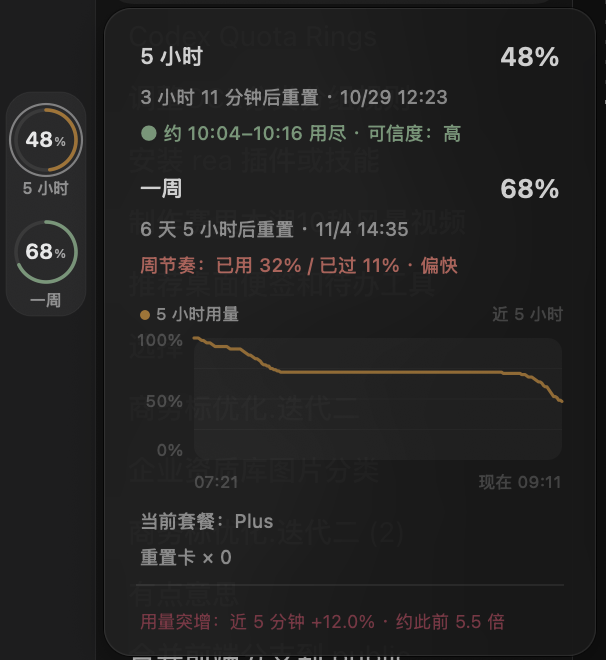

# Codex Quota Rings

**English** · [简体中文](README.zh-CN.md)

A small native macOS widget for the remaining Codex quota in the 5-hour and weekly windows. It offers small rings, an expandable desktop-style card, and private quota trends.

<p align="center">
  <a href="https://github.com/innoerL/codex_quota_rings/releases/latest/download/Quota-Rings.app.zip"><strong>⬇ Download Quota Rings for macOS</strong></a>
  &nbsp;·&nbsp;
  <a href="https://github.com/innoerL/codex_quota_rings/releases/latest">Release notes</a>
</p>

<p align="center"><sub>Universal 2 · Apple Silicon & Intel · macOS 12+</sub></p>



<p align="center"><sub>Desktop screenshot provided by the project owner.</sub></p>

## Download and install

**[⬇ Download the latest ZIP](https://github.com/innoerL/codex_quota_rings/releases/latest/download/Quota-Rings.app.zip)** — no build tools or Terminal setup required.

1. Download and unzip `Quota-Rings.app.zip`.
2. Move **Quota Rings.app** to Applications.
3. Open Codex, sign in normally, then open **Quota Rings.app**.

[View all releases](https://github.com/innoerL/codex_quota_rings/releases) for earlier versions and full update notes.

## Version history

The current version is **1.5.0** (2026-10-28). It adds the minimal single-ring mode and arc ordering, weekly usage pace, reset markers in the trend, smooth quota transitions, system appearance support, and plan and reset-card expiry details. It also fixes the expanded card layout. See the [English changelog](CHANGELOG.md) or [Chinese changelog](CHANGELOG.zh-CN.md); earlier published versions remain in [GitHub Releases](https://github.com/innoerL/codex_quota_rings/releases).

The packaged app is zero-configuration. Quota Rings automatically discovers the registered Codex app, standard application folders, Homebrew locations, and the executable path. No Terminal command or path setting is needed.

Open Codex and sign in normally. If Codex is absent, the expanded widget shows **Install Codex**. Discovery and connection retry automatically.

If Codex is moved or reinstalled, choose **Recheck Codex** from the widget or menu-bar menu. It repeats the same automatic discovery without asking for a path or any Terminal command.

The release is a **Universal 2** app for Apple Silicon and Intel Macs, with macOS 12 as the minimum app target when a compatible Codex installation is available. This community build is ad-hoc signed rather than notarized. If Gatekeeper blocks it, use System Settings → Privacy & Security → Open Anyway after confirming where you obtained the archive.

## Expanded details


The expanded card keeps reset timing, the five-hour forecast, confidence state, and trend inspection in one place. The small forms remain available when you want the least intrusive view. Standard and minimal modes use the same detail-card and text sizes.

## Features

- Large card, small vertical rings, and small horizontal rings.
- **Minimal mode** uses a 42 × 42 rounded square that matches the main card and follows the macOS light or dark appearance. The upper track is visibly shorter than the lower track (36% versus 64% of their combined arc length). By default, the upper arc shows the 5-hour quota and the lower arc shows the weekly quota; their positions can be swapped in the menu. The smaller center label always shows the 5-hour percentage. Each colored arc fills its track according to the selected used or remaining value and uses the selected quota palette. Click or hover for both numeric values in the full-size detail card.
- Standard, minimal, large-card, and quota-detail views follow the macOS light or dark appearance. When macOS switches automatically, backgrounds, text, ring arcs, trends, and halos update immediately. The light appearance uses deeper versions of the same quota colors. Standard rings also gain a light surface so their numbers remain legible over a dark desktop.
- Show when Codex is focused by default, always show, or show on a clear Finder desktop.
- Native AppKit UI, 30-second quota updates, reset countdowns, and no manual refresh button.
- Fresh five-hour and weekly readings ease their ring arcs into the new values over about 0.28 seconds, with the center and detail percentages moving in sync. Initial readings, resets, invalid data, and readings after a reconnect appear immediately instead of animating a reset like ordinary consumption.
- A quiet local spike indicator when the last five minutes of consumption is materially faster than the earlier rolling rate, plus gold text emphasis during the final 15 minutes before the five-hour reset. The ring has no extra reset dot. Neither feature sends notifications or stores usage events.
- Ring palettes: semantic quota status, graphite, warm, or the macOS system accent color.
- Shows the current Codex plan and the real number of saved reset credits in quota details, the expanded card, and the menu. When available credit rows include expiry times, it shows the earliest expiry; count-only responses explicitly say that expiry is unavailable. An unknown plan is labelled unavailable rather than guessed.
- Five-hour forecasts continuously collect the latest 30 minutes of samples in the current quota window, including after an estimate is already visible. Every fresh quota reading recalculates the rate as **total observed consumption ÷ actual elapsed time** and updates the forecast immediately. Before the first valid prediction sample, the widget says “Collecting; forecast will start shortly”; once sampling begins it stays quiet until an estimate is ready. A depletion forecast is shown as a plausible range such as “Around 14:20–14:45”, with a wider range for lower confidence. Confidence rises from Low to Medium and High with a longer observed span and more samples. Estimates after reset are shown as “Will not run out this window”. Weekly quota is never given a depletion-time forecast.
- Expanded large-card details include a **Forecast basis** panel with the sample count, observed time, consumption rate, and confidence so each estimate is explainable. Weekly reset timing, weekly pace, forecast basis, and the trend each have their own row without overlapping.
- If the rate is unstable, the forecast remains conservative until later samples provide a useful estimate.
- Expanded details show the active five-hour prediction sample count.
- Weekly quota details compare the percentage used with the percentage of the current week window elapsed and show fast, on pace, or slow. The state changes only when the difference exceeds ten percentage points. No pace is shown when quota or reset data is invalid or stale. This describes current progress; it does not predict a weekly depletion time.
- The five-hour trend breaks the line when used quota drops by more than 25 percentage points and marks the first sample after that drop with a dashed line and a Reset label. History contains samples, so this is an inferred marker rather than an exact reset time; smaller drops and missing samples do not produce a marker.
- Hover the five-hour trend to inspect the nearest sample’s used percentage, timestamp, and consumption rate. Reset discontinuities never receive a made-up rate.
- Remaining quota colors use four stages: sage at 65% or more, warm gold at 30–64%, terracotta at 10–29%, and deep berry red (`#8E4B58` in dark appearance) below 10%. Light appearance uses higher-contrast shades of the same colors.
- The rings rest when usage is steady and use a slower deep-berry breathing halo below 10% remaining. During a five-hour usage spike, a white halo expands beyond the five-hour ring in standard mode and beyond the single ring in minimal mode, repeating every 1.25 seconds until usage steadies. The large card's five-hour ring uses the same cue.
- While the expanding halo appears, hover text and details show the quota increase within the last five minutes and its speed relative to the earlier rate. The explanation disappears when data is stale. It uses the existing local samples and does not persist usage events.
- When a live five-hour depletion estimate moves by at least ten minutes, the widget briefly says whether the expected run-out time is earlier or later than the prior estimate.
- When the five-hour remaining quota falls below 10%, the widget automatically uses a nearly opaque, high contrast surface until it recovers.
- Drag-end-only Codex snapping: dropping the widget within 28 points of a Codex edge places it with an 8-point gap, then avoids visible ordinary windows and the Dock-safe screen frame. It never follows Codex continuously.
- Hover over the widget for 350 ms to open its full detail card; it closes 250 ms after the pointer has left both the widget and detail. Clicking keeps the detail pinned.

## Controls

Right-click the widget or use its menu bar ring to choose size, small-widget orientation, visibility, opacity, mode, language, whether to show used quota, and trend retention. Drag the widget to move it. Each layout keeps its own position.

The Simplified Chinese menu offers:

| Group | Choices |
| --- | --- |
| 大小 | 大 / 小 |
| 小组件布局 | 竖向 / 横向 |
| 显示范围 | 聚焦 Codex 时显示 / 一直显示 / 聚焦桌面时显示 |
| 透明度 | 不透明（0.97）/ 半透明（0.82）/ 轻透（0.68） |
| 模式 | 标准 / 极简（42 × 42 单圆双弧，圆心显示 5 小时百分比） |
| 极简弧线顺序 | 上方 5 小时 · 下方一周 / 上方一周 · 下方 5 小时 |
| 环形配色 | 额度状态 / 石墨 / 暖色 / 系统强调色 |
| 趋势记录 | 仅本次 · 30 分钟 / 保留 5 小时 |
| 界面语言 | 中文 / English |

## Privacy

The default mode keeps only the latest **30 minutes** in memory and writes no trend file. Choosing **5 hours** explicitly stores timestamp and the two used percentages at:

`~/Library/Application Support/Quota Rings/quota-history.json`

Switching back to the 30-minute session mode immediately deletes that file. Account data, credentials, and raw protocol messages are never written into quota history.

Quota Rings communicates only with the local Codex app-server child process over stdio. It makes no separate network requests. Codex may use its existing authentication and network connection to retrieve account limits.

The plan, reset-card count, and earliest available expiry are read from that same local quota response and are never stored in trend history.

Quota Rings does not read Codex task/session state, display task activity, navigate Codex, send notifications, or make weekly depletion predictions.

## Build from source

Developers need Xcode Command Line Tools and Python 3 for the protocol fixture.

```sh
git clone https://github.com/innoerL/codex_quota_rings.git
cd codex_quota_rings
make test
make build
```

The build compiles arm64 and x86_64 separately, combines them as Universal 2, verifies the ad-hoc signature and ZIP, then writes:

- `build/Quota Rings.app`
- `outputs/QuotaRings/Quota Rings.app`
- `outputs/QuotaRings/Quota-Rings.app.zip`

`make live-check` is an optional read-only account check. Native panel tests require a logged-in graphical macOS session. Running `make build` locally does not perform a GitHub push or upload. Publishing a version separately uploads the verified ZIP and SHA-256 file to GitHub Releases.

## Troubleshooting

- **Widget is hidden:** use the menu bar ring and select Always Show.
- **Codex is missing:** open the widget details and choose Install Codex; Quota Rings keeps rediscovering it.
- **No quota or gray rings:** open Codex, sign in, and leave it online while automatic retry reconnects.
- **History disappeared:** session-only data intentionally clears when the app quits, and selecting the 30-minute mode deletes persisted history.

## Contributing and license

Issues and pull requests are welcome at [innoerL/codex_quota_rings](https://github.com/innoerL/codex_quota_rings). Use synthetic values in public screenshots. The project uses the [MIT License](LICENSE) and is not affiliated with or endorsed by OpenAI.
