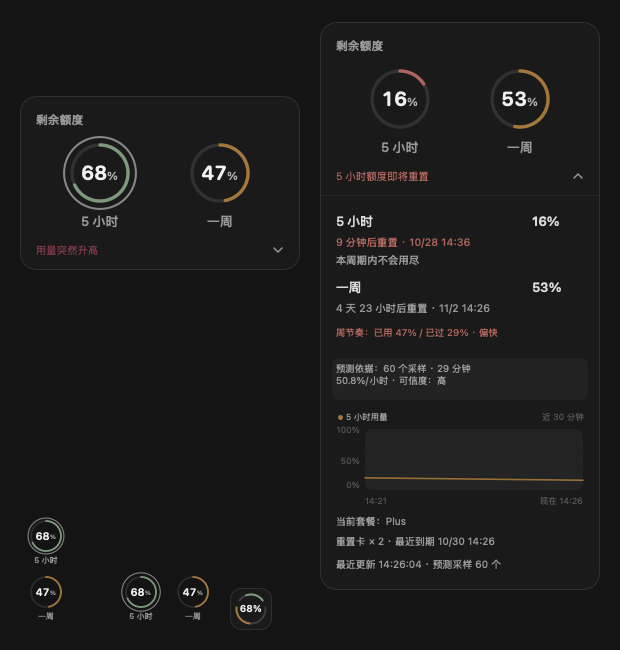
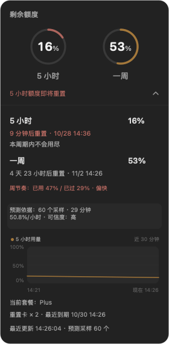

# Codex Quota Rings · 额度双环

[English](README.md) · **简体中文**

一个轻量的 macOS 原生组件，用双环显示 Codex 的 **5 小时**与**一周**剩余额度，并提供额度趋势。

<p align="center">
  <a href="https://github.com/innoerL/codex_quota_rings/releases/latest/download/Quota-Rings.app.zip"><strong>⬇ 下载 macOS 版 Quota Rings</strong></a>
  &nbsp;·&nbsp;
  <a href="https://github.com/innoerL/codex_quota_rings/releases/latest">查看更新说明</a>
</p>

<p align="center"><sub>Universal 2 · 支持 Apple Silicon 与 Intel · macOS 12+</sub></p>



<p align="center"><sub>实际 AppKit 渲染，使用示例额度数据。</sub></p>

## 下载与安装

**[⬇ 下载最新版 ZIP](https://github.com/innoerL/codex_quota_rings/releases/latest/download/Quota-Rings.app.zip)** —— 无需构建工具，也不需要终端配置。

1. 下载并解压 `Quota-Rings.app.zip`。
2. 将 **Quota Rings.app** 拖入“应用程序”。
3. 正常打开 Codex 并登录，再打开 **Quota Rings.app**。

[查看所有版本](https://github.com/innoerL/codex_quota_rings/releases)，可获取旧版本和完整更新说明。

## 版本记录

当前版本为 **1.5.0**（2026-10-28）。本次加入极简单圆与弧线顺序设置、一周使用节奏、趋势重置标记、平滑额度过渡、随系统切换的外观，以及套餐和重置卡到期信息；同时修复大卡片详情排版。完整改动见 [中文版本记录](CHANGELOG.zh-CN.md)，早期已发布版本见 [GitHub Releases](https://github.com/innoerL/codex_quota_rings/releases)。

安装包是**零配置、无需配置路径**的。它会自动查找系统登记的 Codex、标准应用目录、Homebrew 位置及可执行路径，不需要终端命令。

正常打开 Codex 并登录即可。未安装 Codex 时，展开组件会显示“安装 Codex”。安装、移动或重新登录后，组件会自动重新发现并重连。

如果移动或重新安装了 Codex，在组件或菜单栏圆环菜单中选择“重新检查 Codex”即可。它会重新执行首次启动时的自动查找流程，不需要填写路径或使用终端。

安装包为 **Universal 2**，同时支持 Apple Silicon 与 Intel Mac；当本机存在兼容 Codex 时，应用最低目标为 macOS 12。当前社区包使用本地临时签名，没有公证。如果 Gatekeeper 阻止打开，请确认安装包来源后，在“系统设置 → 隐私与安全性”中选择“仍要打开”。

## 展开后的详情



展开卡片会把重置时间、5 小时预测、可信度状态和趋势查看放在同一个界面中；需要尽量低干扰时，可以使用小型布局。标准与极简模式使用同样大小的额度详情和文字。

## 功能

- 大卡片、小型竖向双环、小型横向双环三种布局。
- **极简模式**是与大卡片同色系的 42 × 42 圆角方块，背景随 macOS 浅色／深色外观切换。上弧明显短于下弧，分别占两段可见弧长的 36% 和 64%。默认上弧代表 5 小时额度、下弧代表一周额度，也可在菜单中交换；缩小后的圆心文字始终显示 5 小时额度百分比。彩色弧线按当前“已用／剩余”数值填充各自的轨道，并按各自额度状态使用所选配色；点击或悬停可在原尺寸的详情中查看两个额度的具体数值。
- 标准、极简、大卡片和额度详情均跟随 macOS 的浅色／深色外观；系统自动切换外观时立即更新背景、文字、进度弧、趋势图及光环。浅色外观使用同色系的较深状态色；标准双环也会显示浅色表面，保证放在深色桌面时数字仍清晰。
- 默认聚焦 Codex 时显示，也可以一直显示或只在清晰桌面上显示。
- 原生 AppKit 界面，每 30 秒自动读取额度，显示重置倒计时，无手动刷新按钮。
- 新额度读数到来时，5 小时与一周的进度弧会在约 0.28 秒内平滑移动；圆环中央和额度详情里的百分比同步变化。首次读取、额度重置、数据失效或重连后的读数直接显示，不把重置画成普通消耗过程。
- 当最近五分钟消耗明显快于此前滚动速率时，以低干扰方式提示用量突然升高；5 小时额度最后 15 分钟会以金色文字强调重置倒计时，不在圆环上额外画点。这两项功能不发送通知，也不保存用量事件。
- 环形可选择额度状态、石墨、暖色或 macOS 系统强调色配色。
- 在额度详情、展开卡片和菜单中显示当前套餐与 Codex 返回的真实“可用重置卡 × N”。有可用卡片明细时显示最早到期时间；只有数量时明确显示“未提供到期时间”。未知套餐显示“暂不可用”，不推测套餐等级或卡片日期。
- 5 小时额度会在同一重置周期内持续收集最近 30 分钟的样本，已经出现预测后也不会停止。每收到一次新额度读数，就按“累计消耗 ÷ 实际经过时间”重新计算速率并及时更新预测。尚未获得第一份有效预测采样时，组件会显示“收集中，稍后开始预测”；采样开始后会静默在后台计算，预测形成后直接更新。预测会以“约 14:20–14:45 用尽”这样的可信区间呈现；可信度较低时区间会更宽。观测跨度和样本量增加后，可信度会从低逐步提升到中和高。预测晚于重置时显示“本周期内不会用尽”。一周额度不会预测何时用尽。
- 大卡片展开后会显示“预测依据”面板，列出采样数量、观测时长、消耗速率与可信度，方便判断预测是否可靠。一周重置时间、周节奏、预测依据和趋势图分别占用独立行，不会互相遮挡。
- 如果消耗速率不稳定，预测会保持保守，等待后续采样形成有效估计。
- 展开后的详情会显示当前 5 小时预测采样数量。
- 一周额度详情会比较本周期的已用比例与已过时间比例，显示“偏快／平稳／偏慢”。两者相差超过 10 个百分点才标为偏快或偏慢；缺少有效额度或重置时间、数据过期时不显示节奏。节奏只描述当前进度，不预测一周额度何时用尽。
- 5 小时消耗趋势图在已用比例一次回落超过 25 个百分点时断开曲线，并在回落后的首个采样位置用虚线和“重置”标签标明。历史记录只保存采样值，标记是根据明显回落推断的，不代表精确重置时刻；回落较小或采样断档时不推断。
- 悬停 5 小时趋势图可查看最近采样点的已用比例、采样时间和消耗速率；重置造成的断点不会显示虚假的速率。
- 双环使用四段状态色：剩余 65% 及以上为鼠尾草绿，30–64% 为暖金色，10–29% 为陶土红，低于 10% 为深莓红（深色外观为 `#8E4B58`）。浅色外观采用对比更清楚的同色系版本。
- 用量平稳时双环静止；检测到 5 小时用量突然升高时，标准模式会在 5 小时环外、极简模式会在单圆外循环播放白色扩散光环，每轮约 1.25 秒，用量恢复平稳后停止。大卡片的 5 小时环也使用同一提示。剩余额度低于 10% 时，主环以更慢的深莓红呼吸光晕强调状态。
- 扩散光环出现时，悬停说明和详情会显示近 5 分钟额度增量及相对此前速率的倍数；数据过期时不显示原因说明。这些数值沿用本机采样，不额外保存用量事件。
- 当 5 小时用尽预测相对上一轮前移或后移达到 10 分钟，组件会短暂提示“预测较上次提前/推迟 N 分钟”。
- 5 小时剩余额度低于 10% 时，组件会自动切换到接近不透明的高对比表面，额度恢复后自动退出。
- 仅在拖动结束时吸附：放下位置距 Codex 边缘 28 点内时，组件以 8 点间距吸附，并避开可见普通窗口和 Dock 安全区域；它不会持续跟随 Codex。
- 悬停组件 350ms 后打开完整详情卡片；鼠标同时离开组件和详情卡片 250ms 后收起。点击会固定详情卡片。

## 操作

右键组件或点击菜单栏圆环，可选择尺寸、小组件方向、显示范围、透明度、模式、界面语言、已用/剩余额度和趋势保留方式。拖动组件可调整位置，各种布局分别记住自己的位置。

| 分组 | 选项 |
| --- | --- |
| 大小 | 大 / 小 |
| 小组件布局 | 竖向 / 横向 |
| 显示范围 | 聚焦 Codex 时显示 / 一直显示 / 聚焦桌面时显示 |
| 透明度 | 不透明（0.97）/ 半透明（0.82）/ 轻透（0.68） |
| 模式 | 标准 / 极简（42 × 42 单圆双弧，圆心显示 5 小时百分比） |
| 极简弧线顺序 | 上方 5 小时 · 下方一周 / 上方一周 · 下方 5 小时 |
| 环形配色 | 额度状态 / 石墨 / 暖色 / 系统强调色 |
| 趋势记录 | 仅本次 · 30 分钟 / 保留 5 小时 |
| 界面语言 | 中文 / English |

## 隐私

默认只在内存中保留最近 **30 分钟**的趋势，不写趋势文件。只有用户主动选择 **保留 5 小时**时，才会把时间戳和两个窗口的已用百分比保存在：

`~/Library/Application Support/Quota Rings/quota-history.json`

切回“仅本次 · 30 分钟”会立即删除该文件。额度历史不会写入账户信息、凭证或原始协议内容。

Quota Rings 只通过 stdio 与本机 Codex app-server 子进程通信，自身不发起额外网络请求。Codex 可以使用已有登录状态和网络连接读取账户额度。

套餐、重置卡数量与可用卡片的最早到期时间都只从这份本机额度响应读取，不会写入趋势历史。

Quota Rings 不会读取 Codex 任务或会话状态，不展示任务活动，不会跳转 Codex、不发送通知，也不会预测一周额度何时用尽。

## 从源码构建

开发者需要 Xcode Command Line Tools；协议测试还需要 Python 3。

```sh
git clone https://github.com/innoerL/codex_quota_rings.git
cd codex_quota_rings
make test
make build
```

构建会分别编译 arm64 与 x86_64，合并为 Universal 2，验证本地签名与 ZIP 完整性，然后生成：

- `build/Quota Rings.app`
- `outputs/QuotaRings/Quota Rings.app`
- `outputs/QuotaRings/Quota-Rings.app.zip`

`make live-check` 可选，用于只读检查本机账户。原生窗口测试需要已登录的 macOS 图形会话。本地执行 `make build` 不会上传或推送 GitHub；发布版本时需单独把核验过的 ZIP 和 SHA-256 校验文件上传到 GitHub Release。

## 故障排查

- **看不到组件**：点击菜单栏圆环，把显示范围改为“一直显示”。
- **未找到 Codex**：在展开详情中点击“安装 Codex”；组件会持续自动发现。
- **没有额度或双环变灰**：打开 Codex 并完成登录，组件会自动重试。
- **趋势消失**：仅本次模式会在退出时清空，选择 30 分钟模式也会删除此前持久化文件。

## 参与改进与许可

欢迎在 [innoerL/codex_quota_rings](https://github.com/innoerL/codex_quota_rings) 提交 Issue 或 Pull Request。公开截图请使用合成额度。本项目采用 [MIT License](LICENSE)，与 OpenAI 无隶属关系，也未获 OpenAI 背书。
